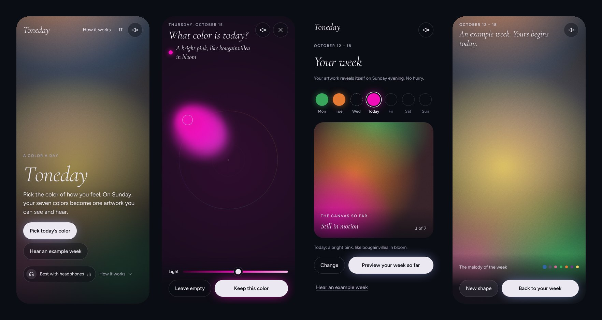

# Toneday

**One color a day. One artwork a week, to see and to hear.**

Toneday is a gentle mood journal without words. Every day you choose the color of how you feel by moving your finger across a surface of ink, and every color has its own sound. On Sunday evening your seven days fall like drops, blend into a single living artwork and play their own melody. You can keep it as your phone wallpaper.

No scores, no streaks, no charts. No account, no ads. Your colors never leave your device.

🇬🇧 English: `/` · 🇮🇹 Italiano: `/it`



## How it works

| Moment | What happens |
|---|---|
| **Every day** | Around the circle the hue changes, toward the edge the color grows more intense, the slider sets its light. Each color is described in a short phrase ("A calm blue, like the sky after rain") and plays live while you choose. |
| **Sunday evening** | The days drop onto the screen one by one, each with a glass chime, then melt into a slowly moving artwork. After the full chord, the days sing a melody, Monday to Sunday, then in variations. Empty days become rests. |
| **The week after** | Save the artwork as a wallpaper, rendered at your screen's full resolution. "New shape" rearranges the same seven colors into a new composition. |

First-time visitors can hear an example week right away.

## Sound design

All sound is synthesized live with the Web Audio API. There are no audio files, so every week sounds unique.

- **One chord for the whole week.** Every color plays one tone of D major 9 (D, A, F♯, C♯, E), voiced openly from D2. Any combination of days is consonant by construction: nothing you choose can sound wrong.
- **Light sets the register**, hue colors it. Darker colors sit low, lighter colors high.
- **Hue sets the timbre**: warm colors are round pads with a slow pulse, yellows and greens crystalline, blues soft and distant with a water texture, greens carry wind, violets float in a long reverb, greys and darks are a low, warm drone.
- **Intensity opens the filter** and the volume together, which is what makes the gesture feel organic.
- **A quiet low D** holds everything together, like a floor under the music.
- With headphones, each day has its own place in the stereo field, Monday on the left to Sunday on the right.

## Principles

- **No pressure.** Nothing to keep up with, no guilt for a skipped day.
- **No numbers.** Only color and sound.
- **Private by design.** Colors are stored only in the browser's `localStorage`. Visits are counted with cookieless Vercel Web Analytics. Fonts and libraries are self-hosted, so nothing is loaded from third parties.
- **Accessible.** Every color is described in words for screen readers, the color surface works with the keyboard, every week can be listened to, and all animation stops when "reduce motion" is on.
- **Not therapy.** Toneday is a creative ritual, not a medical tool. The site points to [findahelpline.com](https://findahelpline.com) for anyone going through a hard time.

## Tech

A static site with no build step and no framework.

| Path | What it is |
|---|---|
| `index.html`, `it/index.html` | The app and landing page, English and Italian (generated) |
| `privacy.html`, `it/privacy.html` | Privacy pages (generated) |
| `assets/app.js` | The whole app: color surface, sound engine, generative artwork, melody, wallpaper export, local storage |
| `assets/app.css` | Styles |
| `assets/vendor/motion-13.4.6.js` | [Motion](https://motion.dev), self-hosted (MIT, see `assets/vendor/LICENSE.md`): screen transitions, the color flying into its day, hero and scroll animations |
| `assets/fonts/` | Cormorant Garamond and Figtree, self-hosted (SIL Open Font License) |
| `sw.js`, `manifest.webmanifest` | Offline support and install on the home screen |
| `og-en.png`, `og-it.png`, `icons/`, `favicon.*` | Social previews and icons (generated) |
| `sitemap.xml`, `robots.txt` | Search engines, with `hreflang` alternates (generated) |
| `vercel.json` | Clean URLs, cache and security headers |
| `tools/build.py` | Generates pages, manifests, sitemap and robots from one bilingual template |
| `tools/images.py` | Generates icons and social previews |

The artwork and the ink are drawn on `<canvas>`. The SEO content (how it works, principles, FAQ, structured data) is real HTML below the full-screen hero.

## Run locally

Any static server works. Clean URLs (`/it`, `/privacy`) need Vercel or a server that maps them to `.html` files.

```sh
npx serve .
```

Sound starts only after the first tap, as browsers require.

## Edit texts or the domain

1. Edit the texts, or `SITE` at the top of `tools/build.py`.
2. Run `python3 tools/build.py`, and `python3 tools/images.py` for the images.
3. When `assets/app.js` or `assets/app.css` change, increase `VERSION` in `tools/build.py`, `CACHE` and the `?v=` numbers in `sw.js`, and the `?v=` in `404.html`, so returning visitors get the new files.

## Deploy

On Vercel: import the repository, framework preset **Other**, no build command, then **Analytics → Enable**. Custom events (`color_kept`, `reveal_started`, `example_week`, `wallpaper_saved`, `listen`, `day_left_empty`) are sent too, but Vercel records them only on the Pro plan.
